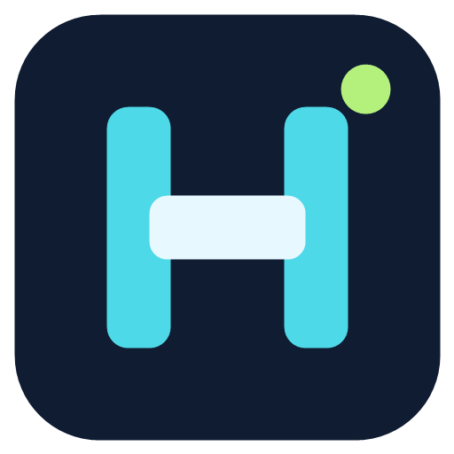

# HoloWin

[](https://github.com/rotsl/HoloWin/actions/workflows/ci.yml)
[](LICENSE)
[](#hardware-support)
[](#build-from-source)
[](#known-limitations)

Desk-tap controls for Windows 11.

[Website and quick start](https://rotsl.github.io/HoloWin/) · [Download EXE](https://github.com/rotsl/HoloWin/releases/latest/download/HoloWin.exe) · [Sponsor](https://github.com/sponsors/rotsl)

HoloWin uses your microphone to recognize taps in four desk zones and run actions you assign to them. Processing runs locally in a native WinUI 3 application. Calibrate each zone for your PC and desk, then use a single accepted tap to trigger its action. You can also click or touch the zone buttons on Dashboard.

Camera Studio tracks hands and maps poses, swipes and custom finger symbols to actions. Light, Bluetooth and presence rules offer other ways to trigger saved actions when the required hardware is available.

Profiles keep calibration and assignments together. The app also has global zone hotkeys, macros and tray controls. Depth, smart-home and raw device-specific sensor protocols are not connected.

## Contents

- [Quick start](#quick-start)
- [Build from source](#build-from-source)
- [Run](#run)
- [Test](#test)
- [Portable EXE distribution](#portable-exe-distribution)
- [Calibration and triggering](#calibration-and-triggering)
- [Action configuration](#action-configuration)
- [Camera gestures and hotkeys](#camera-gestures-and-hotkeys)
- [Hardware support](#hardware-support)
- [Architecture](#architecture)
- [Privacy](#privacy)
- [Known limitations](#known-limitations)
- [Documentation](#documentation)
- [Attribution](#attribution)

## Quick start

If you have the all-in-one EXE, run it directly; it extracts its dependencies automatically. If you have the portable ZIP, extract all files and run its `HoloWin.exe`. No Microsoft Store or MSIX installation is required. For a source checkout, follow the build instructions below.

1. Open Hardware, select your microphone, enable it, and press Apply microphone.
2. In Profiles, create a profile with the Passive sensing strategy, or select an existing profile and press Use selected.
3. In Calibration, collect and save ten taps in each of the four zones.
4. In Actions, save an action, choose a zone, and press Assign selected action.
5. In Settings, select Audio only and save if needed.
6. On Dashboard, press Start listening. Check the active profile and Listening status, then tap an assigned zone once.

Click a zone on Dashboard to test its action independently of microphone detection. Recent events shows accepted/rejected taps and action results. Calibration and evaluation suspend automatic actions until the session is saved or cancelled.

## Build from source

Use Windows 11 build 22621 or later and the .NET 10 SDK. The default development build also needs the .NET 10 desktop and Windows App SDK 1.6 runtimes to run. NuGet restores the project's SDK build tools and native dependencies; OpenCV does not need a separate system installation.

Run these commands in PowerShell:

```powershell
git clone https://github.com/rotsl/HoloWin.git
cd HoloWin

dotnet restore HoloWin.sln
.\scripts\download-hand-model.ps1
dotnet build HoloWin.sln -c Debug --no-restore
```

For a Release build:

```powershell
dotnet build HoloWin.sln -c Release
```

The build helper can also run tests:

```powershell
.\scripts\build.ps1 -Configuration Debug -RunTests
```

Projects target `net10.0-windows10.0.22621.0`. The desktop app defaults to `win-x64`. ARM64 settings exist in the project, but native dependencies and runtime behavior have not been validated for ARM64.

## Run

From the repository root:

```powershell
.\run.ps1
```

This builds the Debug app, starts it in a separate process and returns the terminal prompt. Close the app with its title-bar close button or tray menu; Ctrl+C in the terminal does not close the detached app. To start the existing build without rebuilding, use `.\run.ps1 -NoBuild`.

Console tools:

```powershell
# Enumerate audio inputs; use the app's Hardware page for the full inventory.
dotnet run --project tools/DeviceInspector/DeviceInspector.csproj -c Debug

# Run synthetic fusion throughput measurement for 60 seconds.
dotnet run --project tools/PerformanceBenchmark/PerformanceBenchmark.csproj -c Debug -- --duration=60

# Inspect a saved profile and its evaluation reports using its actual GUID.
$profileId = Read-Host 'Saved profile GUID'
dotnet run --project tools/CalibrationAnalyzer/CalibrationAnalyzer.csproj -c Debug -- $profileId
```

## Test

```powershell
# Build and run the automated tests.
dotnet test HoloWin.sln -c Debug

# Or reuse an existing Debug build.
dotnet test HoloWin.sln -c Debug --no-build --no-restore
```

Tests cover DSP, classification, calibration, persistence, fusion, and selected hardware/action contracts using synthetic fixtures. They do not establish physical desk accuracy or validate every UI and device workflow.

## Portable EXE distribution

To create a single EXE containing all companion files:

```powershell
.\scripts\publish-single-exe.ps1
```

Share `artifacts/standalone/HoloWin.exe` alone. It extracts the bundled app and runtimes to `%LOCALAPPDATA%\HoloWin\releases` on first launch. The camera libraries and verified palm/hand models are included. New releases use separate cache folders and retain your existing profiles/settings.

To build the alternative self-contained Release x64 folder/ZIP:

```powershell
.\scripts\publish.ps1
```

Output:

- `artifacts/HoloWin-win-x64/HoloWin.exe`: launch from this folder.
- `artifacts/HoloWin-win-x64.zip`: share this archive with other users.

For this folder/ZIP format, extract the entire ZIP before launching and keep its companion DLLs and resource folders. Only the all-in-one EXE from `artifacts/standalone` contains those files inside itself. Both formats include the .NET and Windows App SDK runtimes. Each recipient needs Windows 11 build 22621 or later and their own desk calibration.

Equivalent publish command, without ZIP creation:

```powershell
dotnet publish src/HoloWin.App/HoloWin.App.csproj -c Release -r win-x64 --self-contained true -p:WindowsAppSDKSelfContained=true -p:PublishSingleFile=false -p:PublishTrimmed=false -o artifacts/HoloWin-win-x64
```

The Release publish and ZIP contents have been checked; installation on a separate clean machine remains unverified. See [Packaging](docs/PACKAGING.md).

## Calibration and triggering

1. Keep the PC in the position where you intend to use it. Select the profile and microphone first.
2. Press Begin new calibration.
3. Press Prepare for a zone, wait for it to arm, and make ten spaced, natural taps within that zone.
4. Repeat for all four zones. Rejected samples do not count toward the target.
5. Optionally collect negative examples for talking, typing, or room noise using the separate start/stop controls.
6. Press Validate calibration to calculate leave-one-out agreement, then Save calibration.
7. Assign actions and press Start listening on Dashboard. Normal triggering uses one accepted tap, not ten.

For a separate accuracy check, use Evaluation to collect fifteen new trials per zone and save the completed report. Calibration agreement is not a substitute for this held-out evaluation.

Saved profiles contain feature vectors rather than raw audio. Optional debug WAV recording is controlled in Settings and capped at 100 recordings.

## Action configuration

Create an action, enter its parameters, and press Save action. Select the target zone and press Assign selected action. Saving an action by itself does not assign it to any zone. For a website, enter a complete URL such as `https://example.com`.

| Setting | Meaning |
|---------|---------|
| Enabled | Allows the action or zone to run. |
| Cooldown (ms) | Minimum time between executions; 200 ms is 0.2 seconds. |
| Minimum confidence | Required classifier score from 0 to 1. Higher values reject more uncertain taps. |
| Timeout (seconds) | Time before cancellation is requested for a running action. |
| Approval | Allows restricted action types to execute. |
| Confirmation | Asks before each execution. |
| Macro | A sequence of saved actions, with optional delays; a failed step stops the sequence. |

The action editor groups controls by purpose. F1–F10 supports modifiers, and tab switching accepts next/previous or a custom shortcut. Volume and brightness actions change the current level by a configurable step. Brightness needs Windows monitor support; existing absolute-volume actions remain editable.

Other actions include text, websites, files, applications, media controls and virtual desktops. Screenshots, scripts, executables, HTTP requests and macros require approval. See [Actions and macros](docs/AUTOMATION.md) for parameters.

Create dummy example macro saves two feedback-only steps separated by 500 ms without assigning a trigger. To use a macro, add saved actions as steps, save the macro, then create a RunMacro action using its displayed ID and assign that action to a zone. Test action executes a real action.

## Camera gestures and hotkeys

In Actions, select a saved action and assign a pose, swipe or custom finger symbol. The Create tab actions and bind left/right swipes button sets up next/previous tab controls when both assignments are empty. You can edit the shortcuts and assignments afterwards.

Start hand tracking in Camera Studio, check the landmark dots, then enable gesture actions for the session. Focus the application you want to control. Hold a pose steadily and release it before repeating. Tracking stays on across page changes; stop it on Dashboard or through the tray menu.

Settings has a shortcut field for each desk zone. For example, Ctrl+Alt+1 can run a zone action while another app has focus. Hotkeys pause during calibration/evaluation but remain available when sensors are paused. Use Hide window to tray to keep the app running without its window. Closing the window quits.

See [Camera controls](docs/CAMERA_SETUP.md) for model details and practical limits.

Ambient light rules are configured in Actions and armed separately in Hardware after starting sensor readings. They require a Windows light sensor. See [Actions and macros](docs/AUTOMATION.md) for thresholds, hold times and reset margins.

## Hardware support

| Hardware | Current behavior |
|----------|------------------|
| Built-in/USB microphones | WASAPI capture; input selectable in Hardware. |
| Microphone arrays | Multichannel features when exposed by the device and driver. |
| Built-in/USB webcams | Opt-in preview, hand tracking, gesture actions and manual desk mapping. |
| Accelerometer/gyrometer | Discovery and opt-in readings through Windows sensor APIs. |
| Ambient-light sensor | Opt-in readings and above/below/range action rules through Windows sensor APIs. |
| Inclinometer | Discovery and opt-in pitch, roll and yaw readings. |
| Touchscreen/mouse | Manual activation of Dashboard zone buttons. |
| Bluetooth / HID | Opt-in connection/attachment monitoring and action rules; no raw report decoding. |
| Human presence / proximity | Present/absent or near/far rules when Windows exposes a supported sensor. |
| Serial | Inventory only; no configured protocol. |
| Depth/IR and smart home | No configured integration. |

For connection and presence rules, scan sources in Hardware, save a rule in Actions, then start monitoring and enable presence actions in Hardware. See [Presence and device connections](docs/PRESENCE.md).

Dashboard and Hardware use the same inventory. A detected device is not necessarily producing readings; microphone capture, camera preview, and sensor readings have separate start controls. Manual zone buttons can be used without microphone capture.

## Architecture

```text
WASAPI microphone
  -> streaming tap detector and impact gate
  -> feature extraction and calibrated zone classifier
  -> accepted observation -> fusion engine
  -> zone assignment -> action dispatcher
```

`WorkspaceController` connects the WinUI screens to the shared profile, hardware, capture, calibration, evaluation, and action services. Core DSP and contracts are separated from the UI. Persistence stores profiles, settings, action libraries, and evaluation reports as local JSON.

Camera capture uses OpenCV. Two ONNX models detect palms and estimate landmarks; the gesture recognizer routes assigned poses to the action dispatcher. See [Architecture](ARCHITECTURE.md) and [Implementation status](docs/IMPLEMENTATION_STATUS.md).

## Privacy

Desk-tap processing is local, with no telemetry or mandatory cloud service. Microphone and camera capture require explicit start commands. Raw recordings are off by default; debug WAV capture can be enabled in Settings. Preview-only capture stops when its page is left. Hand tracking stays on until you stop the camera or pause sensors.

Profiles, settings, actions, reports, and logs are stored under `%LOCALAPPDATA%\HoloWin`. Configured website or HTTP actions can access the network. See [Privacy](PRIVACY.md).

## Known limitations

- Accuracy depends on the microphone, surface, background noise, and PC position. Recalibrate when the setup changes.
- Speech, typing, and nearby impacts can resemble taps; rejection gates do not eliminate all false triggers.
- Calibration cannot verify that you tapped the intended physical zone.
- Active/hybrid acoustic probing is experimental and requires explicit enablement in Settings.
- Physical tap-to-action behavior needs validation on each setup; automated tests cannot establish it.
- Camera gestures need adequate lighting and a clear hand view. Dynamic plugin loading, depth and smart-home integrations are not connected.
- ARM64 and clean-machine portable deployment remain unverified.

## Documentation

| Document | Topic |
|----------|-------|
| [Implementation status](docs/IMPLEMENTATION_STATUS.md) | Current capabilities and verification limits |
| [Troubleshooting](docs/TROUBLESHOOTING.md) | Launch, capture, and action failures |
| [Packaging](docs/PACKAGING.md) | Portable EXE distribution |
| [Calibration](docs/CALIBRATION.md) | Calibration and evaluation background |
| [Automation](docs/AUTOMATION.md) | Actions and macros |
| [Presence](docs/PRESENCE.md) | Bluetooth, HID and presence rules |
| [Hardware compatibility](docs/HARDWARE_COMPATIBILITY.md) | Device considerations |
| [Camera setup](docs/CAMERA_SETUP.md) | Preview and desk mapping background |
| [Architecture](ARCHITECTURE.md) | Project structure |
| [Testing](docs/TESTING.md) | Automated testing |
| [Privacy](PRIVACY.md) | Local data and sensor policies |
| [Security](SECURITY.md) | Security and reporting |
| [Contributing](CONTRIBUTING.md) | Development contributions |

## Attribution

Derived from [Holo](https://github.com/JustinGamer191/Holo) by JustinGamer191, licensed under MIT.

---

**Author:** Rohan R  
**License:** [MIT](LICENSE)  
**Status:** Experimental research prototype. Automated DSP tests pass; useful accuracy must be measured per device and per desk.
